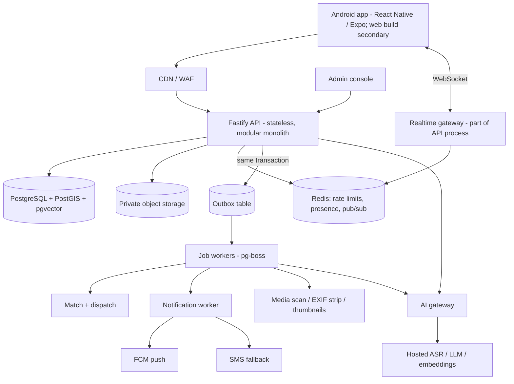

# Conversational Skill Marketplace — Product and Technical Specification v0.5

**Date:** 11 October 2026
**Status:** Engineering specification for the pilot build. Not a security or scale certification.
**Supersedes:** v0.4. This version is self-contained for everything in pilot scope. Deferred v0.4 material (in-app calling §9A, self-hosted models §5–6) stays valid as future reference and is not repeated here.

---

## 0. What changed from v0.4

| # | Decision | Effect |
| --- | --- | --- |
| D1 | **Android-first.** The primary client is an Android app; web is a secondary target from the same codebase. | Replaces "Next.js PWA first, native later". Fixes notification delivery. |
| D2 | **Trust layer at launch:** post-job confirmation and two-way ratings. No verification is required of anyone; Udyam is an optional badge. | New §8. |
| D7 | **Frictionless provider onboarding** is a product priority: phone OTP, describe your skill, confirm, live. | New §5.1. |
| D9 | **The two sides are separated, and the provider side comes first.** At sign-in a person picks "I offer a service" or "I need help" and sees only that side; switching is a deliberate action in settings. The provider side has a private dashboard (status, leads, replies, jobs, rating). This replaces the two-tab home in invariant 1 until both sides have enough people to justify combining them. | App home, onboarding. |
| D8 | **Legal work is deferred until there is traction.** Only items that physically block shipping are kept (§14). | Replaces the v0.5-draft compliance checklist. |
| D3 | **Cut from pilot:** video calls, audio calls, chat translation, photo analysis, AI evidence bundles, agreement summaries by AI. | Smaller build; see §2. |
| D4 | **Contact sharing replaces in-app calls.** Either party may deliberately share their phone number inside a matched chat. | Revises the v0.4 "numbers never shared" invariant; see §9. |
| D5 | **No revenue at launch**, but the data model records leads and agreements so lead fees and transaction commission can be switched on later. | New §15. |
| D6 | Technical fixes from the v0.4 review: authorization model, matching specification, notification fallback, uniqueness rule, scale keys from day one, embedding storage, encryption scope, realtime protocol, full schema. | §5–§12. |

---

## 1. Product invariants

1. Two primary views: **Find Help** and **Offer Help**. A conversations drawer is reachable from both; it is not a third destination.
2. Input is natural speech or text. No profile forms, no public profiles, no browsable directory, no category menus shown to users.
3. One account holds many **private, independently matchable capabilities**. A requester never learns about a provider's other capabilities.
4. A request goes to a **bounded wave** of relevant providers (5 by default). Matching never sends a request below the relevance floor (§7.4).
5. **Language never blocks participation.** Original text and its language are always kept; English and structured facts are derived, versioned, and confirmed by the user in their own language.
6. **The platform never discloses a phone number on its own.** A number reaches the other party only when its owner taps "Share my number" in a specific matched chat (§9).
7. No payments at launch. No recording, no AI listening, no model training on user content without separate consent.
8. Core flows (existing chats, responding to a request, sharing a number, confirming a job) work when every AI service is down.

---

## 2. Scope

### In the pilot
- Android app (and web build of the same app) with the two views and chat.
- Phone OTP sign-in.
- Voice and text input in Marathi, Hindi and English, including Romanised and mixed-language input.
- Capability capture and request parsing with native-language confirmation.
- Matching and dispatch waves with push notifications and SMS fallback.
- Realtime text chat with image attachments (no AI analysis of images).
- Deliberate phone-number sharing in chat.
- Job agreement, post-job confirmation, two-way ratings.
- Report, block, admin console, audit log, account deletion.
- Optional Udyam registration badge (never asked for in onboarding).
- All service categories open, including food, tutoring and in-home work.

### Deferred (not in the pilot)
| Item | Returns when |
| --- | --- |
| In-app audio calls | Number sharing proves insufficient, or commission model needs calls kept in-app |
| Video calls | After audio calls |
| Chat translation | Pilot shows real cross-language conversations failing |
| Photo analysis, AI evidence bundles | Providers ask for help presenting work |
| Spoken (TTS) confirmations | Pilot shows users cannot act on text confirmations |
| Self-hosted models and GPUs | Measured hosted spend exceeds the full cost of self-hosting |
| Police / background verification | Revisit once there is traction; not planned as a gate |
| Payments, lead fees, commission | §15 |
| Legal and compliance review | After traction (§14) |
| iOS app | Demand; the codebase already supports it |

---

## 3. Architecture

A **modular monolith** API with separate worker processes, one PostgreSQL database as the source of truth, and an AI gateway in front of hosted model providers.



---

## 4. Stack

| Layer | Choice | Notes |
| --- | --- | --- |
| Client | **React Native + Expo**, TypeScript. Android is the release target; Expo web export is the web app. | One UI codebase. iOS later from the same code. |
| API | Node.js + TypeScript + Fastify, in containers | Modules: identity, capabilities, requests, matching, conversations, trust, safety, notifications, admin |
| Database | Managed PostgreSQL 16+ with PostGIS and pgvector, Mumbai region | Used as plain Postgres through our backend only |
| Jobs | Transactional outbox + **pg-boss** (Postgres-backed) | Delayed jobs cover wave expiry and reminders |
| Realtime | WebSocket endpoint in the API process; Redis pub/sub once there is more than one instance | Database remains the message store |
| Cache / limits | Redis | Never authoritative |
| Object storage | Private S3-compatible bucket, Mumbai | Signed, short-lived URLs |
| Push | Firebase Cloud Messaging, high-priority data messages | §6 |
| SMS | An Indian SMS provider behind an adapter, DLT-registered templates | OTP and notification fallback |
| Auth | Phone OTP behind an adapter; backend issues its own session tokens | Refresh-token rotation, device binding |
| AI | Internal gateway; hosted providers only in the pilot | §10 |
| Hosting | Container runtime in or near Mumbai that supports long-lived WebSockets | Not a serverless function platform |
| Observability | OpenTelemetry traces, structured logs without message content, error tracking, spend metrics per AI task | |
| Admin | Internal web console on the same API with role-based access | Built before the pilot, not after |

---

## 5. Authentication and authorization

**Decision: authorization is enforced in the backend domain layer. Clients never talk to the database.**

- The app holds only our own session token. No database or vendor credentials ship in the client.
- Every query runs through a domain service that takes an explicit `actor` and checks ownership or participation. There is no code path that loads a row by ID without an actor check.
- Row-level security is **defence in depth only**: the API sets `app.actor_id` per transaction, and policies on `capabilities`, `messages`, `conversations` and `ratings` deny rows the actor has no relation to. A bug in application code then fails closed.
- Vendor realtime products that authorise through database policies are not used. Realtime goes through our own gateway (§11).
- Admin access is a separate role with its own audit trail; reading chat content requires an open report on that conversation.
- A cross-capability leakage test suite runs in CI: guessed IDs, another conversation's attachments, embedding search, rating summaries.

**Phone numbers** are stored with application-level encryption, plus a keyed hash for lookup. Only the identity module can decrypt them.

### 5.1 Frictionless onboarding

The target is **under two minutes from install to a live capability**, with no forms.

1. Open the app, enter phone number, enter OTP (auto-read from SMS on Android).
2. Pick a language (pre-selected from the device language).
3. Land on **Offer Help** or **Find Help** with the microphone ready. Location permission is requested here, with a typed-locality fallback.
4. Speak or type what you can do. The app shows the interpreted skills in your language; tap to confirm. The capability is live immediately.
5. Notification permission and the battery-settings prompt come **after** the first capability is live, framed as "so you don't miss requests".

Nothing else is asked: no name beyond an optional display name, no documents, no email, no category selection, no verification. A display name is requested at first chat if still missing. Adulthood is covered by one line in the sign-up terms, not a separate step.

Funnel metrics tracked from day one: install → OTP done → first utterance → confirmed capability → first notification delivered → first response.

---

## 6. Notification delivery

The dispatch loop depends on providers seeing a request within minutes. This is treated as a first-class system.

1. **Primary: FCM high-priority data message** to the Android app, shown on a dedicated high-importance notification channel with sound.
2. **Delivery receipt:** the app acknowledges receipt to the API. `notification_attempts` records sent, delivered, opened.
3. **Fallback: SMS** if no delivery receipt arrives within 90 seconds (configurable). The SMS carries no request detail beyond "New request near you" and a deep link.
4. **Onboarding step for providers:** the app detects aggressive battery management and walks the provider through exempting the app. Completion is recorded.
5. **Quiet hours:** default 22:00–07:00 per provider, adjustable. Requests arriving in quiet hours are held or sent to other providers.
6. **Provider controls:** pause all, pause one capability, daily cap.
7. **Fatigue rules:** per-provider cap on notifications per day; providers who ignore many requests in a row are ranked lower and prompted to pause.
8. **Web clients** get web push on a best-effort basis and are not counted on for dispatch timing.

Metrics tracked from day one: delivery rate, time to delivered, time to opened, response rate per wave, SMS fallback share and cost.

---

## 7. Matching and dispatch

### 7.1 Hidden taxonomy

Users never see categories. The backend has them.

- `service_categories` is a small tree (about 40 leaves for the pilot, for example `food.prepared_meals`, `education.school_tutoring`, `home.electrical`) plus `other`.
- The parser assigns one category from this closed list. `other` is allowed and is reviewed weekly to grow the list.
- Each category has a **versioned attribute schema** in `packages/contracts` (JSON Schema). Example for `food.prepared_meals`: `item`, `diet` (veg / non-veg / egg / jain), `quantity_min`, `quantity_max`, `unit`, `delivery_offered`, `notice_hours`.
- Attributes in the schema are stored in typed, indexable form. Anything else the model extracts goes into `extra` and is used only for text search, never for filtering.
- Each category carries a **risk tier** label: `standard`, `in_home`, `child_facing`, `food`. It gates nothing at launch. It exists so safety rules can be added per tier later without re-labelling data.

### 7.2 Location

- A provider's base location is a private point plus a service radius. It is never sent to any client other than the owner's.
- Each capability and request also stores an **H3 cell** (resolution 8, roughly neighbourhood sized) and a **`cell_id`** naming the city cell (for example `pune`).
- A requester's exact address exists only if they type it into a chat.

### 7.3 Pipeline

```text
request confirmed by requester (immutable request_version)
  1. Hard filters in SQL, in this order:
       same city cell (or remote-capable category)
       PostGIS: request point within provider service radius
       capability active, provider not paused, not in quiet hours
       category compatible (same leaf, or mapped neighbours)
       typed attribute constraints (diet, quantity range, notice period, date)
       no block in either direction; provider under daily cap
  2. Score the surviving candidates (typically tens to low thousands):
       exact cosine similarity on embeddings (no approximate index needed at this size)
       + full-text score on original and English text
  3. Drop everything below the relevance floor.
  4. Rank: relevance x trust prior x responsiveness x distance decay,
       with fairness cooldown and one exploration slot per wave for new providers.
  5. Deduplicate by provider account. Reserve slots.
  6. In one transaction: insert matches + outbox events.
  7. Notify wave.
```

An approximate vector index is added only when a single cell's filtered candidate set regularly exceeds about 50,000 rows.

### 7.4 Relevance floor

- The floor is a numeric threshold on the combined score, calibrated against a labelled evaluation set of real pilot-language requests and capabilities.
- It is set for precision: it is better to tell a requester "no one yet" than to notify an irrelevant provider.
- The floor, the model versions and the evaluation result are stored in configuration with a version. Changing an embedding model requires recalibration before rollout.

### 7.5 Waves and request lifecycle

| Parameter | Default |
| --- | --- |
| Wave size | 5 providers |
| Wave expiry | 10 minutes (shorter when the request deadline is within 3 hours) |
| Maximum waves | 3 (15 providers) |
| Request lifetime | Until its deadline, or 48 hours if none |

Request states: `draft → confirmed → dispatching → responded → agreed → completed`, with terminal `cancelled`, `expired`, `no_match`.

- The requester sees honest live status: "Sent to 5 providers nearby. 2 have seen it."
- A wave closes early when it expires or all five have declined. The next wave starts only if fewer than 2 providers have responded.
- **Zero candidates or zero responses:** the requester is told plainly. The request stays open, and newly activated matching capabilities are notified until it expires.
- Agreeing with one provider closes the request to further waves; other responders are told it is filled.

### 7.6 Guarantees enforced in code and constraints

- `UNIQUE (request_id, provider_account_id)` on `matches`: a provider is notified at most once per request, across all waves and capabilities.
- Dispatch is idempotent on `(request_version_id, wave_no)`.
- Notification payloads contain no location more precise than neighbourhood, and nothing about the provider's other capabilities.

---

## 8. Trust

### 8.1 Job agreement
Inside a chat either party taps **"We've agreed"** and fills a short card: what, when, and optionally the price. The other party confirms. This creates an `agreements` row. The chat works without it; the agreement is what unlocks confirmation and rating.

### 8.2 Post-job confirmation
After the agreed time, both parties are asked **"Did this job happen?"**

| Requester | Provider | Result |
| --- | --- | --- |
| Yes | Yes | `completed` |
| Yes | No answer in 72 h | `completed` |
| No answer in 72 h | Yes | `completed_unconfirmed` (counts for neither side's totals) |
| No | Yes, or the reverse | `disputed`, visible to admin |
| No | No | `not_done` |

### 8.3 Ratings
- Only for `completed` jobs. One rating each way, 1–5 with optional tags and comment.
- Both ratings are hidden until both are submitted or 7 days pass, to prevent retaliation.
- Ratings attach to the **capability**, not the account.
- What a requester sees when a provider responds is a single **trust line** for that capability only: "Verified · 12 jobs completed · 4.7". There is no profile page and nothing about other capabilities.
- New capabilities show "New" and get the exploration slot in waves so they can earn a first job.
- Requester ratings are visible to providers as a similar line on incoming requests.
- Admin can void ratings tied to fraud or abuse reports. Rating between accounts sharing a device or number is blocked.

### 8.4 Verification

- **Required:** a verified phone number. Nothing else, for anyone, in any category.
- **Optional:** a provider may add a Udyam registration number from settings at any time. It shows as "Registered business" on their trust line and gives a small ranking benefit. It is never asked for during onboarding.
- **Not planned as a gate:** police or background verification. If added later it would be another optional badge first.

Trust at launch therefore comes from completed jobs and ratings, not documents. Udyam registration is self-declared, so the badge says "Registered business" and nothing stronger.

### 8.5 Safety baseline at launch
- Report and block in every chat and on every request; blocked pairs are never matched again.
- Standing scam warning in chat when a message mentions advance payment, UPI links or OTPs (rule-based, no AI).
- Accounts are for adults, stated in the sign-up terms.
- Admin queue for reports and disputes with defined response times.

---

## 9. Contact sharing

- A **"Share my number"** button exists in a matched chat. Tapping it shows a confirmation, then posts a system message with the sharer's number, visible only in that conversation.
- Sharing is one-directional and per-conversation. The other party is not prompted or pressured to reciprocate.
- The number is tappable to open the phone dialler or WhatsApp. Calls happen outside the app.
- Each share is logged in `contact_shares` (who, which conversation, when) for abuse handling and as a signal for future lead billing.
- Typed numbers in ordinary messages are not blocked. The app does not claim it can prevent disclosure.
- Phone numbers never appear in notifications, API responses, logs or analytics.

---

## 10. AI pipeline

Pilot uses **hosted providers only**, through the internal gateway. Requirements for any provider: no training on our data, and short or zero retention.

| Task | When | Fallback |
| --- | --- | --- |
| Speech to text | Voice submit; clips capped at 60 s | Typed input |
| Interpret request | First submission and material edits | Ask the user to rephrase; never dispatch unparsed |
| Interpret capabilities | Provider describes or updates skills; splits multiple skills into separate records | Same |
| Embed | Once per capability version and per request version | Full-text only, with a stricter floor |
| Confirmation text | Generated in the user's language from the structured facts | Template per category |

Not in the pilot: translation, TTS, vision, bundle drafting, agreement summaries.

**Rules carried forward from v0.4:**
- The original text or transcript is always stored with its language. English and structured facts are derived and versioned, never a replacement.
- Nothing is dispatched or activated until the user confirms the interpreted facts in their own language. Quantities, prices, dates, dietary restrictions and negations must appear in that confirmation.
- The model never invents price, delivery, licences or location.
- Model output is untrusted input: it is schema-validated, and no model output can trigger data access outside the actor's own capability or request.
- The gateway owns routing, timeouts, retries, schema validation, per-task spend caps and circuit breakers. Each call is logged in `ai_runs` without user text.
- Audio is deleted after successful transcription and confirmation unless the user separately consents to retention.

**Release gate:** native speakers evaluate at least 300 real utterances across Marathi, Hindi, English, Romanised and mixed input. Measured: transcription accuracy on task-critical words, category accuracy, attribute accuracy for quantity/date/price/negation, and invented-fact rate. The model choice follows this evaluation, not published benchmarks. Model names and prices listed in v0.4 are unverified candidates.

---

## 11. Chat and realtime

- **Send:** client generates a UUIDv7 `client_message_id`, posts over HTTPS. The server deduplicates on it, stores the row, and assigns a per-conversation sequence number `seq`.
- **Deliver:** the gateway pushes the message over WebSocket to connected participants. If the recipient is offline, a push notification is queued.
- **Catch-up:** on connect or reconnect the client sends its last known `seq` per conversation (or one global cursor) and receives everything after it. The app is fully usable from this path alone; WebSocket is an optimisation.
- **Offline:** outgoing messages queue locally and send on reconnect with the same `client_message_id`.
- **Receipts:** `delivered_seq` and `read_seq` per participant per conversation, not per message.
- **Attachments:** direct upload to private storage using a single-use signed URL; a worker scans, strips EXIF and makes a thumbnail before the attachment becomes visible to the other party. Images only in the pilot, 10 MB cap.
- **Scaling:** gateways are stateless apart from live sockets; Redis pub/sub fans out across instances.

---

## 12. Data model

### 12.1 Conventions (all tables)
- Primary keys are **UUIDv7** (time-sortable).
- Every domain table carries **`cell_id`** (city cell) from day one. Global tables (`accounts`) carry a home cell.
- `created_at`, `updated_at` on every table; soft-delete columns where deletion must be auditable.
- Append-heavy tables are **range-partitioned by month from day one**: `messages`, `outbox_events`, `notification_attempts`, `audit_events`, `ai_runs`. Old outbox and attempt partitions are dropped, which avoids queue-table bloat.
- All storage is encrypted at disk level. **Application-level encryption** applies only to phone numbers and verification documents. Message and capability text is not column-encrypted, so full-text search works.

### 12.2 Core tables

```text
accounts(id, phone_enc, phone_hash UNIQUE, display_name NULL, home_cell_id,
         preferred_locale, status, terms_version_accepted, created_at, deleted_at)
sessions(id, account_id, device_id, refresh_token_hash, fcm_token, platform,
         battery_exempt_confirmed, last_seen_at, revoked_at)
provider_settings(account_id PK, paused, quiet_start, quiet_end, daily_cap)

service_categories(id, parent_id, slug UNIQUE, risk_tier, attribute_schema_version, active)

utterances(id, account_id, purpose, input_type, original_text, source_locales[],
           canonical_en, audio_object_key, audio_expires_at, created_at)
interpretations(id, utterance_id, version, category_id, attributes jsonb, extra jsonb,
                model_version, prompt_version, status)       -- draft | confirmed | rejected

capabilities(id, account_id, cell_id, category_id, status,       -- draft | active | paused | removed
             base_point geography, service_radius_m, h3_r8, remote_ok,
             current_version_id)
capability_versions(id, capability_id, version_no, interpretation_id, original_text,
                    canonical_en, attributes jsonb, search_tsv tsvector, confirmed_at)

requests(id, account_id, cell_id, category_id, status, point geography, h3_r8,
         deadline_at, expires_at, current_version_id)
request_versions(id, request_id, version_no, interpretation_id, original_text,
                 canonical_en, attributes jsonb, search_tsv, confirmed_at)   -- immutable

capability_embeddings_<model_key>(capability_version_id PK, embedding vector(N))
request_embeddings_<model_key>(request_version_id PK, embedding vector(N))
     -- one pair of tables per embedding model, so dimensions are fixed per table;
     -- embedding_models(model_key, dims, active, floor_config_version) tracks them

dispatch_waves(id, request_id, request_version_id, wave_no, state, opens_at, expires_at,
               UNIQUE(request_version_id, wave_no))
matches(id, request_id, wave_id, capability_id, provider_account_id, score, rank,
        state,                                   -- notified | seen | interested | declined | expired
        UNIQUE(request_id, provider_account_id))
notification_attempts(id, match_id, channel, state, sent_at, delivered_at, opened_at, cost_minor)

conversations(id, match_id UNIQUE, request_id, capability_id, requester_id, provider_id,
              cell_id, last_seq, status)
conversation_participants(conversation_id, account_id, delivered_seq, read_seq, muted)
messages(id, conversation_id, seq, sender_id, client_message_id, kind, body, source_locale,
         created_at, deleted_at,
         UNIQUE(conversation_id, seq), UNIQUE(conversation_id, client_message_id))
media_assets(id, owner_id, conversation_id, object_key, scan_state, mime, bytes)
contact_shares(id, conversation_id, shared_by, created_at)

agreements(id, conversation_id, what, scheduled_for, price_minor NULL, currency,
           proposed_by, confirmed_at, state)
job_confirmations(agreement_id, account_id, answer, answered_at)
ratings(id, agreement_id, rater_id, ratee_id, capability_id NULL, stars, tags[], comment,
        revealed_at, voided_at, UNIQUE(agreement_id, rater_id))
capability_trust(capability_id PK, completed_jobs, rating_avg, rating_count, response_rate)
requester_trust(account_id PK, completed_jobs, rating_avg, rating_count)

verifications(id, account_id, kind,              -- udyam only at launch; extensible
              reference_enc, state, checked_at)

blocks(blocker_id, blocked_id, created_at, PRIMARY KEY(blocker_id, blocked_id))
reports(id, reporter_id, subject_account_id, conversation_id, reason, state, assigned_to)
moderation_actions(id, report_id, admin_id, action, note)
consents(id, account_id, scope, version, granted_at, revoked_at)

outbox_events(id, aggregate_type, aggregate_id, event_type, payload jsonb, cell_id,
              created_at, processed_at)
lead_events(id, provider_account_id, match_id, kind, price_minor DEFAULT 0, created_at)
ai_runs(id, task, provider, model_id, prompt_version, usage jsonb, est_cost, status, latency_ms)
audit_events(id, actor_id, actor_role, action, target_type, target_id, created_at)
```

### 12.3 Key indexes
- `capabilities`: GiST on `base_point`; btree on `(cell_id, category_id, status)`; GIN on current version `search_tsv`.
- `matches`: `(provider_account_id, created_at)` for caps and fatigue; `(request_id)`.
- `messages`: `(conversation_id, seq)`.
- `outbox_events`: partial index on unprocessed rows.

---

## 13. Scale path

### 13.1 Rough load at national scale (estimates to validate, not targets)
| Measure | Assumed at 1 million requests per day | Per second |
| --- | --- | --- |
| Requests | 1 M/day | ~12 average, ~60 peak |
| Notifications | ~5 M/day first wave | ~60 average, ~300 peak |
| Chat messages | ~20 M/day | ~230 average, ~1,000 peak |
| Concurrent sockets | 200–500 thousand | 10–20 gateway instances |

A partitioned Postgres primary can carry this write volume. Cells are introduced mainly to limit blast radius and keep indexes small, not because one database cannot keep up.

### 13.2 Order of extraction from the single database
1. **Jobs and outbox** to a dedicated broker, when job throughput is sustained in the hundreds per second or vacuum lag appears.
2. **Read replicas** for matching queries and admin reporting.
3. **Messages** to their own cluster, split by `cell_id`.
4. **City cells** for capabilities, requests and matches; accounts stay global.
5. **Dedicated search or vector tier**, only if recall or latency measurements require it.

Because every table already has `cell_id`, UUIDv7 keys and time partitions, steps 3 and 4 are data moves, not redesigns.

### 13.3 Phases
| Phase | Situation | Posture | Gate to next |
| --- | --- | --- | --- |
| P0 pilot | 30–50 providers, one Pune locality | One API instance, one worker, managed Postgres, hosted AI | 20–30 real completed jobs, no privacy leak, delivery rate measured |
| P1 | Thousands of accounts, one city | Multiple API instances, Redis pub/sub, separate worker pools | Response time, delivery rate, cost per request stable |
| P2 | Several cities | Replicas, broker, autoscaling; legal review and monetization start here | Load tests pass at 5x current peak |
| P3 | National | Cells, messages cluster, possible self-hosted inference | Driven by measurements |

### 13.4 Operations baseline (before the pilot)
- Environments: local, staging, production; migrations run forward-only through CI.
- Backups with point-in-time recovery. Targets: lose at most 5 minutes of data, restore within 4 hours. A restore drill is run before launch and quarterly.
- Secrets in a managed secret store; none in the app bundle or repository.
- Rate limits per account, device and IP on OTP, request creation, messages and reports.
- Alerts on: notification delivery rate, job queue lag, API error rate, AI spend per day, SMS spend per day.

---

## 14. Legal: deferred, except what blocks shipping

**Decision:** no legal or compliance review before launch. It is revisited at the P1 → P2 gate, when there are real users. Food, tutoring and in-home categories are all open in the pilot with no licence checks.

Three items stay because without them the app cannot be published or cannot sign users in. They are shipping blockers, not legal projects:

| Item | Why it blocks | Effort |
| --- | --- | --- |
| **SMS sender registration (DLT)** | Indian telecom operators drop unregistered commercial SMS, so OTPs and fallback alerts would not arrive. A managed OTP service that sends under its own registration avoids this for sign-in; fallback alerts still need our own. | Paperwork with the SMS provider; start early, it takes days to weeks |
| **Privacy policy page and in-app account deletion** | Google Play rejects apps with accounts that lack either. | A template policy and the deletion flow already in the build order |
| **Terms of use accepted at sign-up** | One tap; states the platform only introduces people and accounts are for adults. | A template |

Kept for cheapness, not compliance: consent records, the audit log, and the list of which outside services receive user data. Each is a table already in the schema and would be expensive to reconstruct later.

**Accepted risks of deferring** (recorded so the choice is deliberate): data-protection obligations, food-seller licensing, and platform duties around reported content are unreviewed. The trigger to revisit is the P2 gate, a serious incident report, or any plan to charge money, whichever comes first.

---

## 15. Monetization hooks (nothing is charged at launch)

Two models are anticipated. The schema supports both without migration.

**A. Lead fees to providers.**
- `lead_events` already records every delivered notification, every "interested" response and every contact share, at price zero.
- Switching on means adding a provider wallet or subscription and setting prices per category. Billing by "interested" response or by contact share is fairer than billing per notification.

**B. Commission on transactions (freelance-platform model).**
- `agreements.price_minor` already captures agreed price.
- Later: payment collection through a licensed payment aggregator's marketplace/split product, so the platform never holds funds itself; commission is deducted at payout.

**Tension to plan for:** number sharing makes it easy to settle off-platform, which undermines commission. Lead fees are compatible with number sharing; commission is not unless the app offers something worth staying for (payment protection, dispute handling, in-app calls, verified-job ratings). The likely sequence is lead fees first, commission later alongside in-app calling.

Taxes and invoicing obligations for either model need accounting advice before launch of billing.

---

## 16. Repository layout

```text
apps/
  mobile/        # Expo app: Android primary, web export secondary
  api/           # Fastify modular monolith + realtime gateway
  worker/        # pg-boss workers: dispatch, notify, media, ai
  admin/         # internal console
packages/
  contracts/     # API types, event envelopes, category attribute schemas
  domain/        # authorization, matching, trust rules
  ai-gateway/    # provider adapters, policies, schema validation
  telemetry/
infra/
  migrations/  docker/  deploy/  monitoring/
docs/
  SPEC.md  THREAT_MODEL.md  PRIVACY_AND_CONSENT.md  RUNBOOKS.md  EVALS.md  ACCEPTANCE_TESTS.md
```

---

## 17. Build order

1. Contracts, schema and migrations; authorization layer with the leakage test suite.
2. Phone OTP, sessions, account deletion, consent records.
3. Admin console skeleton, audit log, report and block.
4. AI gateway with one hosted ASR, LLM and embedding provider; evaluation harness and first labelled set.
5. Capability capture and request parsing with native-language confirmation.
6. Taxonomy, matching pipeline, relevance floor calibration, waves.
7. Notification system: FCM, delivery receipts, SMS fallback, quiet hours, battery-exemption onboarding.
8. Chat: send, catch-up, WebSocket, attachments, number sharing.
9. Agreement, job confirmation, ratings, trust lines; optional Udyam badge.
10. Observability, alerts, backups and restore drill, rate limits, load test.
11. Play Store listing (privacy policy page, deletion flow), then pilot in one Pune locality.

SMS sender registration is started in parallel with step 1 because of its lead time.

---

## 18. Acceptance tests (pilot release gate)

**Privacy and authorization**
- [ ] A requester in a biryani chat cannot obtain anything about that provider's other capabilities through guessed IDs, search, trust lines or attachments.
- [ ] No phone number appears in any API response, notification, log or analytics event except the system message created by "Share my number".
- [ ] Deleting an account removes or anonymises personal data within the published period.

**Onboarding**
- [ ] A new provider goes from first app open to a live capability in under two minutes on a budget Android phone, with no form fields beyond phone number and OTP.
- [ ] No document, email or verification is requested at any point in onboarding.

**Language**
- [ ] A provider describing three unrelated skills in spoken Marathi with English words yields three separate capabilities.
- [ ] `मला आज रात्री ८ वाजेपर्यंत १ किलो बिर्याणी पाहिजे` keeps 1 kg, today and 20:00, with no invented price or delivery.
- [ ] Mixed Hindi-English, Romanised Marathi and negations pass the human-rated evaluation thresholds.
- [ ] Nothing is dispatched or activated without user confirmation.

**Matching and notifications**
- [ ] A provider is never notified twice for the same request across waves or capabilities.
- [ ] A request with no candidate above the floor notifies nobody and tells the requester so.
- [ ] A vegetarian-only request never reaches a non-veg-only capability.
- [ ] On five common budget Android phones, at least 95% of notifications are delivered within 60 seconds with the app closed; the rest trigger SMS.
- [ ] Quiet hours, pause and daily cap are respected.

**Chat and trust**
- [ ] Messages sent offline arrive once, in order, after reconnect.
- [ ] Ratings are possible only after a completed job and stay hidden until both sides rate or 7 days pass.
- [ ] Blocked users are never matched or able to message.

**Resilience**
- [ ] With all AI providers disabled, existing chats, responses, number sharing, agreement and rating still work.
- [ ] A database restore from backup is performed successfully.

---

## 19. Open questions

1. Which SMS and OTP provider, and who handles sender registration.
2. Hosting provider for the pilot.
3. The pilot locality and how the first 30–50 providers are recruited.

---

**Status note:** This is a specification, not a working system. No part of it has been built or load-tested. Legal review is deliberately deferred (§14).
