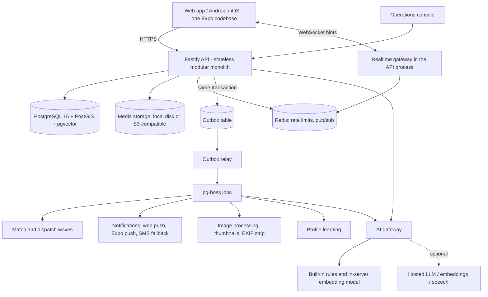

# Conversational Skill Marketplace — Product and Technical Specification v0.6

**Date:** 15 October 2026
**Status:** Describes the application as built on the `main` branch. It is a specification, not a security or scale certification.
**Supersedes:** v0.5. This document is self-contained. Visual design (colours, typography, layout styling) is intentionally out of scope and is not specified here.

---

## 0. Summary

A phone-first app for India, piloting in Pune, that helps people turn a talent into a second income. A person says what they are good at (cooking biryani, maths tuition, guitar, websites, plumbing), the app understands it, and quietly sends them nearby people who need exactly that. People who need help describe what they need in their own words and the app finds a few suitable people nearby. The two then chat, agree, do the job, and confirm it happened; ratings from real jobs build trust.

There are no forms, no public profiles, no browsable directory and no payments. Marathi, Hindi and English are supported throughout. The default configuration has no recurring AI cost.

One codebase produces the web app (live first), the Android app (APK built) and the iOS app (later).

---

## 1. Decisions

| # | Decision |
| --- | --- |
| D1 | **Web app first, Android and iOS from the same code.** Expo / React Native; the web export is served by the API. |
| D2 | **Trust from real jobs**: post-job confirmation by both sides and two-way ratings. No verification gate for anyone; Udyam registration is an optional badge. |
| D3 | **Cut from scope**: video calls, in-app audio calls, chat translation, payments. |
| D4 | **Phone numbers are shared deliberately** by their owner inside a matched chat, never by the platform. |
| D5 | **No revenue at launch**; the data model records leads, contact shares and agreed prices so lead fees or commission can be switched on later. |
| D6 | **Legal work deferred** until traction, except what blocks shipping (§15). |
| D7 | **Frictionless onboarding**: phone number, code, say your talent. Nothing else is required. |
| D8 | **Talent first, and it is not called a "service".** The first audience is working people with a side talent who want a second income; small businesses can join too. |
| D9 | **Three tabs**: My profile, Find help, Messages. Messages holds all chats, marked by the user's role in each, and "My people". |
| D10 | **AI builds each person's private profile** from their chats and work photos, with privacy safeguards (§10.4). |
| D11 | **No recurring AI cost by default**: rule-based understanding, an in-server open embedding model for matching, rule-based profile learning on English chats only, and the device's own speech recognition for voice. Hosted models are an optional per-environment switch. |
| D12 | **Proper delivery process**: one GitHub repository, `dev → staging → main` branches with checks, three environments. |

---

## 2. Product invariants

1. Input is natural speech or text. No profile forms, no category menus shown to users, no public profiles, no browsable directory.
2. One account holds many **private, independently matchable talents** (capabilities). A person who needs help never learns about a provider's other talents.
3. A request goes to a **bounded wave** of relevant people (5 by default) and never to anyone below the relevance floor (§7.4).
4. **Language never blocks participation.** The original words and their language are always kept; English and structured facts are derived, versioned, and confirmed by the user in their own language before anything goes live.
5. **The platform never discloses a phone number on its own** (§9).
6. No payments, no call recording, and no model training on user content. AI reads chats and work photos only to build that person's own private profile, and only while both people in the chat allow it.
7. Core flows (existing chats, responding to a request, sharing a number, agreeing, confirming, rating) work when every AI service is off.
8. Every screen carries one idea. Optional things are offered gently and can be skipped.

---

## 3. Scope

### Built
- Web app (installable, works offline for reading), Android APK, same code ready for iOS.
- Phone sign-in with one-time code; several code-delivery options (§5).
- Welcome carousel aimed at people with a talent, with a browsable list of about 225 talent ideas in 11 groups.
- Talent capture by voice or text in Marathi, Hindi and English, including Romanised and mixed input; several talents in one sentence become separate talents.
- Request capture the same way, with confirmation before sending.
- Matching and dispatch waves; live lead arrival; web push and native push; SMS fallback.
- Realtime chat with text, photos and voice notes; deliberate number sharing.
- Job agreement, post-job confirmation, two-way ratings with delayed reveal, review pop-up.
- "My people": people a user saved or finished a job with.
- Optional proof of work per talent (links and photos), private to the owner.
- AI-built private profile facts from chats and work photos, deletable line by line, with an opt-out.
- Report, block, scam warning, account deletion, privacy and terms pages.
- Operations console: metrics, reports, disputes, uncategorised requests, Udyam checks, matching floor, audit log, server errors.

### Deferred
| Item | Returns when |
| --- | --- |
| In-app audio and video calls | Number sharing proves insufficient, or commission needs calls kept in-app |
| Chat translation | Real cross-language chats fail in the pilot |
| Payments, lead fees, commission | §16 |
| Police or background verification | After traction; would start as an optional badge |
| Public profile pages, proof visible to customers | Product decision pending |
| Profile learning from Marathi and Hindi chats | Only with a hosted model switched on |
| Translated talent-idea list | Wording review in Marathi and Hindi |
| iOS release, Play Store listing | §14.3 |
| Legal and compliance review | §15 |

---

## 4. Architecture

A **modular monolith**: one Fastify API process that also serves the web app, the WebSocket gateway, the operations console and the legal pages; background jobs in the same process during the pilot (or a separate worker process); one PostgreSQL database as the source of truth; Redis for limits and realtime hints.



---

## 5. Stack

| Layer | Choice |
| --- | --- |
| Client | Expo SDK 57, React Native 0.86, expo-router, TypeScript. Web export served from the API's own origin. |
| API | Node.js 24, TypeScript, Fastify 5, `@fastify/websocket`, `@fastify/static`, `@fastify/cors` |
| Database | PostgreSQL 16 with PostGIS and pgvector |
| Jobs | Transactional outbox plus pg-boss (Postgres-backed); inline in the API in the pilot |
| Realtime | WebSocket per client; Redis pub/sub carries hints; clients fetch data over HTTPS |
| Media | Private storage, local disk in the pilot, S3-compatible later; signed short-lived URLs |
| Push | Web Push (VAPID keys generated and stored by the server) and Expo push for native apps |
| Sign-in codes | Adapter: `dev`, `pilot`, `fast2sms`, `twofactor`, `sms`, `http` |
| SMS | Adapter: `dev`, `http`, `phone` (an Android phone acting as SMS gateway), `whatsapp` (Meta Cloud API) |
| AI | Internal gateway; defaults need no AI service (§10) |
| Speech to text | The device's own recogniser via `expo-speech-recognition`; optional server transcription |
| Monorepo | pnpm workspaces, Node 24, TypeScript ~5.9, vitest, tsx |
| Hosting (free staging plan) | Supabase (Postgres) plus Render (web service and Key Value), defined in `render.yaml` |
| Container | Multi-stage Dockerfile: web export stage, then server; image published to GHCR on release |

---

## 6. Authentication, authorization and onboarding

### 6.1 Authorization
- Clients hold only our own session token. No database or vendor credentials ship in any client.
- Every query runs through a domain service that takes an explicit actor and checks ownership or participation.
- **Row-level security as defence in depth**: the API connects as a restricted role and sets `app.actor_id` (or `app.system` for jobs) in each transaction. Policies deny rows the actor has no relation to; elevated access is explicit in code.
- The database's public data API is locked down so a hosted Postgres provider cannot expose tables.
- Admin access uses a separate token, every admin action is audited, and reading a chat requires an open report on it.
- Phone numbers are stored encrypted (AES-GCM) with a keyed hash for lookup; only the identity module decrypts them.

### 6.2 Sessions
- Short-lived access token plus rotating refresh token bound to a device.
- `POST /v1/auth/otp/start`, `/verify`, `/refresh`, `/logout`; per-number and per-IP rate limits.

### 6.3 Sign-in code providers
| Mode | Use |
| --- | --- |
| `dev` | Local development; code printed in the server log |
| `pilot` | One shared code for an allow-list of phone numbers; for testing before an SMS provider exists |
| `fast2sms` | Fast2SMS OTP route (cheapest Indian option; sends under its own registration) |
| `twofactor` | 2Factor.in |
| `sms` / `http` | Our own SMS adapter or any HTTP SMS gateway |

### 6.4 Onboarding flow
1. **Welcome carousel**: who the app is for (a talent, a side income), how it works (we find people who need you, spread the word, build your profile over time), and examples of talents. A small link opens the full list of talent ideas; picking one carries it into the first talent prompt.
2. **Language**: Marathi, Hindi or English, picked on the welcome screen and changeable in settings.
3. **Phone number**, then **code**.
4. **Guided "Add a business" flow** opens straight after the first sign-in, one question per screen, each answered by speaking or typing (§8.2). Only the first question is required; every other step can be skipped.
5. When it is done, the person lands on **My profile**, showing their name, number, area and the business they just listed.
6. Alerts permission is asked once a business is live, framed as "so you don't miss requests".

Nothing else is required: no documents, email, category choice or verification. A display name is optional and requested at first chat if missing. Adulthood is covered by the terms.

Funnel events recorded: install, code requested, code verified, first utterance, confirmed talent, first notification delivered, first response.

---

## 7. Matching and dispatch

### 7.1 Hidden taxonomy
- About 45 hidden categories (for example food, tutoring, music, fitness, home repair, beauty, events, digital work, paperwork, handmade goods) plus `other`, each with multilingual keywords.
- Categories carry a risk tier label (`standard`, `in_home`, `child_facing`, `food`) that gates nothing yet.
- Related categories are "siblings" and can match each other when the semantic similarity is high (at least 0.72), so a slightly mis-categorised talent still finds its requests.
- Each category has a typed attribute schema (for example diet, quantity, unit, delivery, notice). Attributes in the schema are filterable; anything else goes into `extra` for text search only.
- Requests that land in `other` are listed in the operations console to grow the taxonomy.

### 7.2 Location
- A provider's base point and service radius are private; they are shown only to the owner, who can change them.
- Every talent and request stores a PostGIS point, an H3 neighbourhood cell and a `cell_id` naming the city (for example `pune`).
- A requester's exact address exists only if they type it into a chat.

### 7.3 Pipeline
```text
request confirmed (immutable request version)
  1. Hard filters in SQL:
       same city cell
       request point within provider's service radius (PostGIS)
       talent active, provider not paused, not in quiet hours
       category same leaf, or sibling with high similarity
       typed attribute constraints (diet, quantity, notice, date)
       no block either way; provider under daily cap
  2. Relevance = 0.75 x semantic similarity + 0.25 x lexical match (+0.05 same leaf)
  3. Drop everything below the relevance floor
  4. Rank = relevance x trust prior x responsiveness x distance decay x fairness x attention
       fairness lowers people notified often in the last 24 hours;
       one exploration slot per wave goes to a new talent
  5. One provider account at most once per request
  6. One transaction: insert wave and matches + outbox events
  7. Notify the wave
```

### 7.4 Relevance floor
- Stored in `matching_config` per embedding model, adjustable from the operations console.
- Set for precision: "no one yet" is better than notifying the wrong person.
- Defaults: 0.35 for the in-server MiniLM model, 0.5 for hosted Gemini embeddings. Changing the embedding model requires recalibration against the evaluation set.

### 7.5 Waves and request lifecycle
| Parameter | Default |
| --- | --- |
| Wave size | 5 |
| Wave expiry | 10 minutes (shorter near a deadline) |
| Maximum waves | 3 |
| Request lifetime | Until its deadline, or 48 hours |

States: `draft → confirmed → dispatching → responded → agreed → completed`, with terminal `cancelled`, `expired`, `no_match`.
- The requester sees honest live status ("Sent to 5 people nearby. 2 have seen it.").
- The next wave starts only if fewer than 2 have responded.
- No candidates: the requester is told plainly; the request stays open for newly added talents until it expires.
- Agreeing with one person closes the request; other responders are told it is filled.

### 7.6 Guarantees
- `UNIQUE (request_id, provider_account_id)` on matches.
- Dispatch is idempotent per request version and wave number.
- Notifications carry no location finer than neighbourhood and nothing about other talents.

---

## 8. Screens and flows

### 8.1 Navigation
Three bottom tabs, plus settings and chat screens:

| Tab | Purpose |
| --- | --- |
| **My profile** | The provider side: status ("looking for work for you"), this week's numbers (requests, replies, jobs, rating), missed requests, alerts prompt, people who need you (incoming leads), your talents, and the box to add a talent |
| **Find help** | The customer side: describe what you need, confirm, then follow live status and responses |
| **Messages** | Every chat, marked by the user's role in it (helping or being helped), plus **My people** |

### 8.2 My profile
The first screen after sign-in. From top to bottom:
- **About you** (visible only to the owner): name (tap to add or change), phone number (masked), area and travel distance (tap to change), and the "looking for work for you" status.
- **Requests waiting for an answer**, if any: what is needed, roughly where, when, and the requester's trust line; reply "I can help" or "Not for me".
- **My businesses**, with **+ Add a business**. Each card shows what it is, the experience answer and the person's own words about it, the trust line, photos, links (Instagram, Facebook, LinkedIn, website), and the private facts the AI has learned (each deletable). Actions: edit, pause or resume, remove, add photos or links.
- This week's numbers, then earlier requests.

**Guided "Add a business" flow** (also used to edit a business), in four steps:
1. **What do you do?** Speak or type in plain words; the app shows what it understood (one card per skill if several were described) to confirm or change.
2. **Have you done this before?** "I run it as a business", "for friends and family", or "not yet, but I am good at it", plus an optional few words ("5 years, about 200 orders"). Where the person is, if not already known.
3. **Photos**: past work if they have done it before; otherwise "show us something you have made" (a photo, certificate or sample). Optional.
4. **Are you online?** Instagram, Facebook, LinkedIn and any other link; a plain handle such as "@name" becomes the page address. Optional.

The business goes live at the end of step 2; photos and links are added to it as they are given. Experience answers, photos and links are private to the owner for now.

### 8.3 Find help
- Describe the need; the confirmation shows quantities, dates, prices and diet restrictions exactly as understood.
- After sending: live status, then responders with a trust line for that talent only.
- Cancel at any time.

### 8.4 Messages and chat
- Chat supports text, photos and voice notes (60-second cap), delivery and read state, and a scam warning when a message mentions advance payment, UPI, QR codes or OTPs (English, Hindi, Marathi).
- **Share my number** posts the sharer's number into that chat only, after a confirmation.
- **We've agreed**: a short card (what, when, optional price) that the other side confirms.
- **Save person** adds them to My people; finishing a job adds them automatically.
- Report and block from every chat.

### 8.5 Review pop-up
After the agreed time, a pop-up asks "Did this job happen?" and then for a 1–5 rating with optional tags and comment. Pending reviews are fetched on app open.

### 8.6 Settings
Name, language, alerts, quiet hours, pause all, daily cap, Udyam number (optional), AI learning switch, blocked people, sign out, delete account.

---

## 9. Contact sharing
- "Share my number" exists only in a matched chat, is one-directional, and is logged in `contact_shares`.
- The number is tappable to call or open WhatsApp; calls happen outside the app.
- Typed numbers in ordinary messages are not blocked; the app does not claim it can prevent disclosure.
- Phone numbers never appear in notifications, API responses (other than that system message), logs or analytics.

---

## 10. AI

### 10.1 Gateway
All model use goes through one gateway that owns routing, timeouts, schema validation, a daily spend cap, a circuit breaker (three failures pause a hosted model for a minute) and run logging in `ai_runs` without user text. Model output is untrusted input: schema-validated and never able to reach data outside the actor's own records.

### 10.2 Configuration
| Setting | Options | Default (no recurring cost) |
| --- | --- | --- |
| `AI_INTERPRETER` | `rules`, `openai_compat` (e.g. Gemini), `anthropic` | `rules` |
| `AI_EMBEDDER` | `local` (hash), `minilm` (in-server), `openai_compat` | `minilm` |
| `AI_LEARNER` | `auto`, `rules`, `off` | `rules` |
| `AI_ASR` | `none`, `openai_compat` (e.g. Groq Whisper) | `none` |

### 10.3 Tasks
| Task | Default behaviour | With a hosted model |
| --- | --- | --- |
| Understand talents and requests | Keyword rules in Marathi, Hindi and English; splits several skills; extracts quantity, unit, date, deadline, diet with negation handling ("no egg", "don't want non-veg") | LLM with prompt v2, guarded by the same negation rules |
| Confirmation text | Template per category in the user's language | Same |
| Matching vectors | all-MiniLM-L6-v2 (23 MB, 384 dimensions) inside the server; vectors stored per model in `capability_embeddings_<key>` / `request_embeddings_<key>` | Hosted embeddings |
| Voice input | The phone or browser recognises speech in the app language; words appear in the box to check before sending | Server transcription as fallback where the device has no recogniser |
| Profile learning from chats | Rule patterns on English chats: jobs taken, agreed and quoted prices, notice needed, delivery or pickup, usual timings, what customers praised. Non-English chats are skipped. | LLM extraction in any language plus a short profile summary |
| Work photos | Stored only | Described in a line for the profile |

### 10.4 Profile learning safeguards
- Runs after an agreement is confirmed and when a job completes.
- Both people in the chat must have AI learning switched on (on by default, changeable in settings).
- Phone numbers, links and payment handles are removed before any text leaves the server.
- Only facts about the provider's own work are kept; customer details are never written into a profile.
- Voice notes are not read.
- Results are private to the provider, who can delete any line.

### 10.5 Rules carried forward
- The original words are always stored with their language; derived English and facts are versioned, never a replacement.
- Nothing is dispatched or activated until the user confirms in their own language. Quantities, prices, dates, diet restrictions and negations must appear in the confirmation.
- The model never invents price, delivery, licences or location.
- Audio clips for transcription are deleted after use.

### 10.6 Evaluation
`pnpm eval` runs 25 labelled cases (categories and facts, including Marathi, Hindi, Romanised and negation cases). Current result in the default mode: 25/25 categories and 27/27 facts. A larger human-rated set of real pilot utterances is a release gate (§18).

---

## 11. Notifications
1. **Native apps**: Expo push to a high-importance channel.
2. **Web app**: Web Push with server-generated VAPID keys and a service worker.
3. **Delivery receipt**: the client acknowledges; `notification_attempts` records sent, delivered, opened.
4. **SMS fallback** if no receipt within 90 seconds; the SMS says only that there is a new request nearby, with a link.
5. **Quiet hours** (default 22:00–07:00), **pause all**, **pause one talent**, **daily cap**.
6. **Fatigue**: people who ignore many requests are ranked lower.

Realtime in-app updates (new lead, new message, status changes) arrive over the WebSocket as hints; the app refetches over HTTPS, so it works from polling alone if the socket drops.

---

## 12. Chat and realtime
- **Send**: the client generates a UUIDv7 `client_message_id`; the server deduplicates on it and assigns a per-conversation `seq`.
- **Catch-up**: on reconnect the client sends its last known positions (`POST /v1/sync`) and receives everything newer.
- **Offline**: outgoing messages queue locally and resend with the same id.
- **Receipts**: `delivered_seq` and `read_seq` per participant.
- **Attachments**: images (processed, EXIF stripped, thumbnailed before the other side sees them, 10 MB cap) and voice notes (audio, 60 s). Files are served only to participants through signed links; links to files on our own server are relative, so each app joins them to the server address it already uses.

---

## 13. Data model

### 13.1 Conventions
- UUIDv7 primary keys (generated by the SQL function `uuid_v7()`).
- `cell_id` on every domain table.
- Monthly range partitions on `messages`, `outbox_events`, `notification_attempts`, `ai_runs`, `audit_events`.
- Application-level encryption for phone numbers and verification references only, so text search works.
- Forward-only migrations in `packages/core/migrations` (`001`–`009`), run in CI and on deploy.

### 13.2 Tables
| Area | Tables |
| --- | --- |
| Identity | `accounts` (incl. `ai_learning`), `otp_challenges`, `sessions`, `provider_settings`, `consents`, `verifications` |
| Taxonomy and AI | `service_categories`, `utterances`, `interpretations`, `embedding_models`, `matching_config`, `capability_embeddings_<key>`, `request_embeddings_<key>`, `ai_runs` |
| Talents and requests | `capabilities` (incl. `experience`, `experience_note`), `capability_versions`, `capability_proofs`, `profile_insights`, `requests`, `request_versions` |
| Dispatch | `dispatch_waves`, `matches` (`UNIQUE(request_id, provider_account_id)`), `notification_attempts`, `lead_events` |
| Chat | `conversations`, `conversation_participants`, `messages` (kinds incl. text, image, audio, system), `media_assets`, `contact_shares`, `saved_people` |
| Trust | `agreements`, `job_confirmations`, `ratings`, `capability_trust`, `requester_trust` |
| Safety and operations | `blocks`, `reports`, `moderation_actions`, `audit_events`, `funnel_events`, `server_errors`, `server_keys`, `outbox_events` |

### 13.3 Key indexes
GiST on capability base points; `(cell_id, category_id, status)` on capabilities; GIN on version search text; `(provider_account_id, created_at)` and `(request_id)` on matches; `(conversation_id, seq)` on messages; partial index on unprocessed outbox rows.

---

## 14. API, environments and delivery

### 14.1 API surface (`/v1`)
- **Auth and account**: `auth/otp/start`, `auth/otp/verify`, `auth/refresh`, `auth/logout`, `me` (get, update, delete), `me/device`, `me/provider-settings`, `me/verification`, `config`.
- **Talents**: `interpret`, `interpretations/:id/reject`, `capabilities` (list, confirm, update, revise), `capabilities/:id/proofs`, `proofs/:id`, `profile/insights`, `provider/area`, `provider/summary`.
- **Requests and leads**: `requests` (confirm, list, get, cancel), `matches` (list, respond, ack).
- **Chat**: `conversations` (list, get, messages, share-number, receipts, agreement, save-person), `sync`, `media` (create, upload, complete, get, file).
- **Trust**: `agreements/:id/confirm|withdraw|answer|rate`, `reviews/pending`, `people`.
- **Safety**: `reports`, `blocks`.
- **Other**: `/health`, `/v1/ws`, `/app.apk`, `/legal/privacy`, `/legal/terms`, `/legal/delete-account`, `/admin` (console) and `/admin/api/*`.

### 14.2 Environments and branches
| Environment | Branch | Where |
| --- | --- | --- |
| Development | `dev` (default branch) | A developer's Mac via Docker (Postgres on 55432, Redis on 56379) |
| Staging | `staging` | Render free web service + Supabase, from `render.yaml` |
| Production | `main` | To be decided before public launch |

Work happens on feature branches with pull requests into `dev`, then `dev → staging → main`. CI runs typecheck, migrations, 26 integration tests against a separate test database, and the AI evaluation. A release workflow builds the server image to GHCR; another keeps the free staging service awake. Secrets live only in `.env` (never committed) and the hosting provider's settings.

### 14.3 Clients
- **Web**: served by the API at its own address; installable; index never cached, assets fingerprinted.
- **Android**: `pnpm build:apk [server-address]` builds an arm64 APK without Android Studio; `APP_ENV=staging|production` gives a separately installable app that refuses plain http. EAS profiles exist for development, staging and production. Play Store needs a $25 one-time developer account and a closed test with 12 testers for 14 days on a personal account.
- **iOS**: the same code; needs an Apple developer account ($99 a year).

---

## 15. Legal: deferred, except what blocks shipping
| Item | Status |
| --- | --- |
| SMS sender registration (DLT) | Avoided for sign-in by using an OTP provider that sends under its own registration; needed later for our own SMS alerts |
| Privacy policy (including how AI is used), terms, account deletion page | Built and served at `/legal/*` |
| Terms accepted at sign-up | Built |

Accepted risks, recorded deliberately: data protection, food-seller licensing and platform duties around reported content are unreviewed. Revisit at the multi-city stage, after a serious incident, or before charging money.

---

## 16. Monetization hooks (nothing charged)
- **Lead fees**: `lead_events` records notifications, "interested" responses and number shares at price zero.
- **Commission**: `agreements.price_minor` records the agreed price; collection would go through a licensed payment aggregator later.
- Number sharing makes off-platform settlement easy, so lead fees come first and commission only alongside something worth staying in-app for.

---

## 17. Scale path
- Every table already has `cell_id`, UUIDv7 keys and time partitions, so later splits are data moves.
- Extraction order: jobs to a broker → read replicas → messages cluster by cell → city cells → dedicated vector tier only if measurements require it.
- Rough national load at 1 M requests a day: about 60 requests, 300 notifications and 1,000 messages per second at peak, 200–500 thousand sockets.

| Phase | Situation | Gate to next |
| --- | --- | --- |
| P0 pilot | 30–50 providers, one Pune locality, one server | 20–30 real completed jobs, no privacy leak, delivery rate measured |
| P1 | One city | Stable response time, delivery rate and cost |
| P2 | Several cities; legal review and monetization start | Load tests at 5x peak |
| P3 | National | Driven by measurements |

The default server (with the in-server model) runs in 358 MB, inside a free 512 MB host.

---

## 18. Acceptance tests (pilot gate)

**Privacy**
- [ ] A requester cannot learn anything about a provider's other talents through guessed IDs, search, trust lines or attachments.
- [ ] No phone number appears anywhere except the "Share my number" message.
- [ ] Profile facts never contain customer details, numbers or links, and are visible only to their owner.
- [ ] Account deletion removes or anonymises personal data.

**Onboarding**
- [ ] First open to a live talent in under two minutes on a budget Android phone, with only phone number and code.

**Language**
- [ ] Three skills described in one Marathi sentence yield three talents.
- [ ] `मला आज रात्री ८ वाजेपर्यंत १ किलो बिर्याणी पाहिजे` keeps 1 kg, today and 20:00, with no invented price or delivery.
- [ ] Negations ("no egg", "don't want non-veg") are kept.
- [ ] Voice input produces correct words in Marathi, Hindi and English on a real phone.
- [ ] Nothing is dispatched or activated without confirmation.

**Matching and notifications**
- [ ] Nobody is notified twice for the same request.
- [ ] A request with no one above the floor notifies nobody and says so.
- [ ] A vegetarian request never reaches a non-veg-only talent.
- [ ] At least 95% of notifications are delivered within 60 seconds with the app closed; the rest trigger SMS.
- [ ] Quiet hours, pause and daily cap are respected.

**Chat and trust**
- [ ] Offline messages arrive once, in order.
- [ ] Ratings only after a completed job, hidden until both rate or 7 days pass.
- [ ] Blocked people are never matched and cannot message.

**Resilience**
- [ ] With every AI service off, chats, responses, number sharing, agreement and rating still work.
- [ ] A database restore from backup succeeds.

---

## 19. Current status

**Verified**: end-to-end flows in a browser at phone size (sign-in, talents, requests, live leads, chat, number sharing, agreement, confirmation, rating, proof of work, three tabs); 26 automated tests; evaluation 25/25; no-cost mode in a 512 MB container; voice typing with a simulated recogniser.

**Not yet verified**: the APK on a real phone, real push delivery, Fast2SMS, WhatsApp, Supabase and Render staging, voice on a real phone, Marathi and Hindi wording review by native speakers.

## 20. Open questions
1. Whether proof of work and learned facts should ever be shown to customers.
2. Whether "Find help" should stay request-based or also offer browsing.
3. Production hosting and the Play Store account type (personal or business).
4. The pilot locality and how the first 30–50 providers are recruited.
